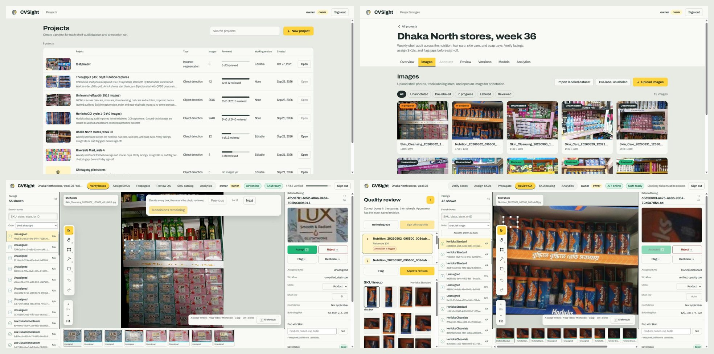

# CVSight

[](https://github.com/atikulmunna/CVSight/actions/workflows/check.yml)

CVSight is a self-hosted platform for building annotated datasets of retail shelf
photos. Teams label and verify products, review and freeze dataset versions, export them
for training, and can feed a trained detector back in to pre-label the next batch.



The projects list, a project's images, the annotation canvas, and quality review with
the SKU lineup.

## Features

- **Annotation for dense shelves:** keyboard-driven verification, undo and redo,
  multi-select, copy and paste, a shelf-row strip, and review ordered by confidence.
- **Project types:** object detection with boxes, or instance segmentation with product
  outlines drawn by hand or with SAM 3.
- **SAM 3 assistance** (optional GPU service): smart box, smart polygon, and Find with
  SAM, which proposes every matching product on a photo from example boxes or a phrase.
- **SKU identity:** a shared catalog, SKU candidates from image embeddings, propagation
  to similar crops, and a per-SKU lineup during review.
- **Versions:** a risk-ranked review queue and a sign-off that freezes each version into
  an immutable snapshot.
- **Exports:** COCO (with segmentation), YOLO, YOLO segmentation, CSV, CreateML and
  TFRecord, split so related photos never cross the train, validation and test sets.
- **Models:** RF-DETR training from snapshots, an evaluated model registry with
  promotion and rollback, and a pre-labeling worker.
- **Analytics:** realogram, gaps and share of shelf, computed only from frozen
  snapshots.
- **Access control:** owner, reviewer and annotator roles enforced by the API, with
  audit events.

Built with React and TypeScript, FastAPI, PostgreSQL with pgvector, and a background
job worker. Labeling needs no GPU; detectors and SAM run as separate, optional services.

## Quick start

Requires Git and Docker (Docker Desktop on Windows or macOS, or Docker Engine with the
Compose plugin on Linux).

```sh
git clone https://github.com/atikulmunna/CVSight.git
cd CVSight
docker build -f docker/api/Dockerfile -t cvsight-api:0.3.0 .
docker run --rm -it cvsight-api:0.3.0 python -m shelfsight_api.auth_cli
```

The last command asks for a password and prints a hash that starts with `scrypt:`.
Create a `.env` file in the project folder:

```sh
SHELFSIGHT_DB_PASSWORD=replace-with-letters-and-digits
SHELFSIGHT_AUTH_USERS='[{"username":"owner","role":"owner","password_hash":"scrypt:..."}]'
CVSIGHT_SITE_ADDRESS=localhost
```

Start the stack (the first build takes several minutes), then open `https://localhost`
and sign in as `owner`:

```sh
docker compose up -d --build
```

The certificate comes from the app's own authority, so browsers warn on the first visit.
[Deployment and operations](docs/deployment.md) covers trusting it, adding users,
access from other devices, backups and troubleshooting.

## Development

```powershell
Copy-Item .env.example .env   # set a database password and an owner hash
uv sync
npm --prefix frontend install
docker compose --env-file .env -f compose.dev.yaml up -d database
docker compose --env-file .env -f compose.dev.yaml exec database createdb -U shelfsight shelfsight_test
. ./scripts/load-env.ps1
uv run alembic upgrade head
./scripts/dev.ps1             # serves http://127.0.0.1:5173
```

Create the owner hash with `uv run python -m shelfsight_api.auth_cli`.
`./scripts/check.ps1` runs every test and check; CI runs the same script. See
[First-time setup](docs/deployment.md#first-time-setup) for details.

## Workflow

1. **Create a project** and choose its type. Optionally import a SKU catalog CSV.
2. **Add photos** by upload, bulk import, or a labeled YOLO or COCO dataset.
3. **Label:** verify, draw or outline products and assign SKUs. A promoted detector can
   pre-label new photos.
4. **Review and release:** work through the risk-ranked queue, then sign off to freeze
   an immutable snapshot.
5. **Export and train:** download a training dataset, train and evaluate RF-DETR, and
   promote the model so it pre-labels the next batch.
6. **Analyze:** realogram, gaps and share of shelf from released snapshots.

## Roles

| Role | Can | Cannot |
| --- | --- | --- |
| `owner` | Everything: create projects, upload and import images, edit the catalog, run jobs, review and sign off, export, manage models, read analytics | |
| `reviewer` | Label and assign SKUs, approve or flag review items, sign off releases | Upload, create projects, propagate, export, run jobs, read analytics |
| `annotator` | Label and assign SKUs, confirm propagation, mark images reviewed | Upload, create projects, review, export, run jobs, read analytics |

The API enforces the same boundaries and records denied requests as audit events.

## Documentation

| Guide | Contents |
| --- | --- |
| [Deployment and operations](docs/deployment.md) | Requirements, setup, Docker Compose, Tailscale, accounts, migrations, quality checks, troubleshooting |
| [Annotation](docs/annotation.md) | Canvas controls, smart box, smart polygon, Find with SAM, SKU catalog, propagation, review and sign-off, annotation API |
| [Datasets](docs/datasets.md) | Image storage, labeled import, progress, versions and exports |
| [Models](docs/models.md) | Model boundary, background jobs, pre-labeling, embeddings, RF-DETR training, model registry, FiftyOne |
| [Analytics](docs/analytics.md) | Realogram reconstruction, gap and availability analysis |

Policies: [security](SECURITY.md), [recovery](RECOVERY.md), [releases](RELEASE.md),
[licenses](LICENSE_POLICY.md), [benchmarks](BENCHMARKS.md) and
[performance](PERFORMANCE.md).

## Contributing

- Run `./scripts/check.ps1` before every commit: Python tests, Ruff, mypy, frontend
  tests, ESLint, TypeScript and the production build.
- Run `./scripts/security-check.ps1` and `./scripts/license-check.ps1` before a release.
- Add tests for new logic, including failure paths, independent of network, time and
  order.
- Keep interface copy in sentence case, and do not use the em dash in code or
  documentation.

## License

MIT, see [LICENSE](LICENSE). Third-party components, datasets and checkpoints are
listed in [LICENSE_POLICY.md](LICENSE_POLICY.md). The screenshots use field captures
from the CVSight shelf audit program and ground-truth labels from the QPDS-Seg dataset,
published under CC BY 4.0.
